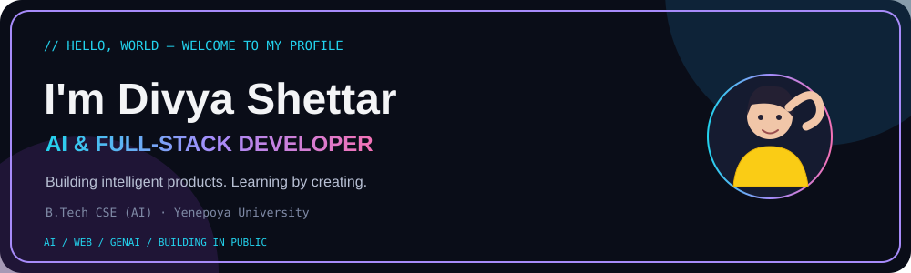
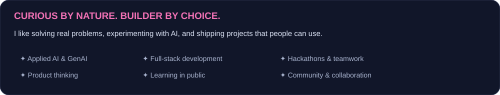
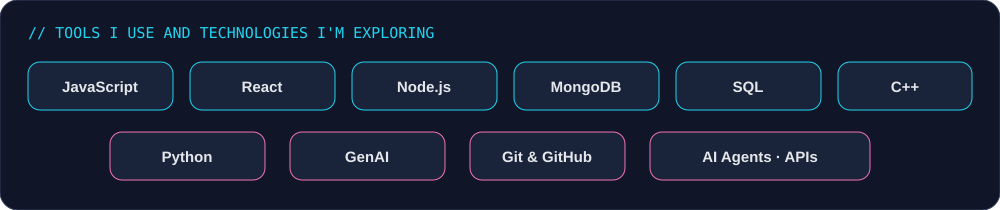
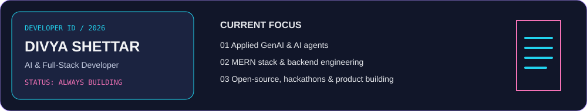
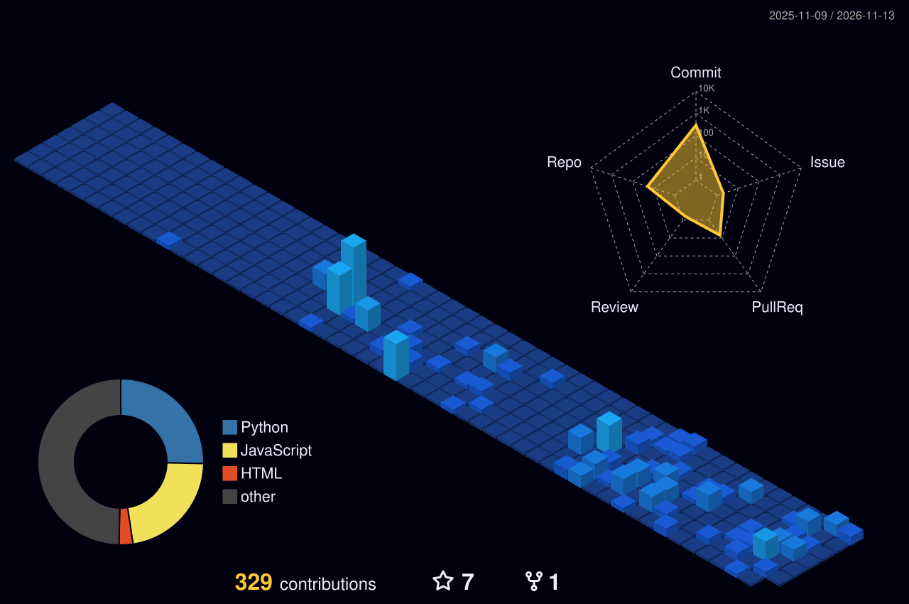
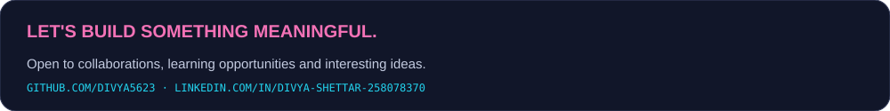

<!--
DIVYA'S ANIMATED GITHUB PROFILE
1. Create a PUBLIC repository named exactly: divya5623
2. Upload this README.md and the assets/ and .github/ folders.
3. Replace the email placeholder in this file and assets/connect.svg.
4. In the repository, enable Actions if they are disabled.
-->

  

  <a href="https://github.com/divya5623">GitHub</a> ·
  <a href="https://linkedin.com/in/divya-shettar-258078370">LinkedIn</a> ·
  <a href="https://my-portfolio-d7hh.vercel.app">Portfolio</a>

---

## // WHAT I BUILD

  

I’m Divya, a B.Tech CSE (AI) student at Yenepoya University. I enjoy turning ideas into useful products through software, AI and thoughtful design. I’m currently exploring full-stack engineering, applied GenAI and AI agents.

## // TECH ORBIT

  

**Currently working with:** JavaScript · React · Node.js · Express · MongoDB · SQL · C++ · Python · Git · GitHub · GenAI

## // DEVELOPER ID

  

## // FEATURED BUILDS

| Project | What it does | Stack |
|---|---|---|
| [DIHI – Digital Intelligent Health Interface](https://github.com/divya5623) | Exploring simpler access to medicine information and health guidance | AI · Web · HealthTech |
| [SheGuard X](https://women-safety-xzdw.vercel.app) | Women’s safety concept with SOS and location-focused features | Web · PWA |
| [Weekend Explore](https://weekend-explore.vercel.app) | AI-powered budget-friendly weekend trip planning | AI · Travel · Web |
| [Complete MERN](https://github.com/divya5623/Complete-MERN) | Full-stack learning and implementation | MongoDB · Express · React · Node.js |

## // CONTRIBUTION CITY

  

## // CONNECT

  

  Building, learning, experimenting — one commit at a time.

